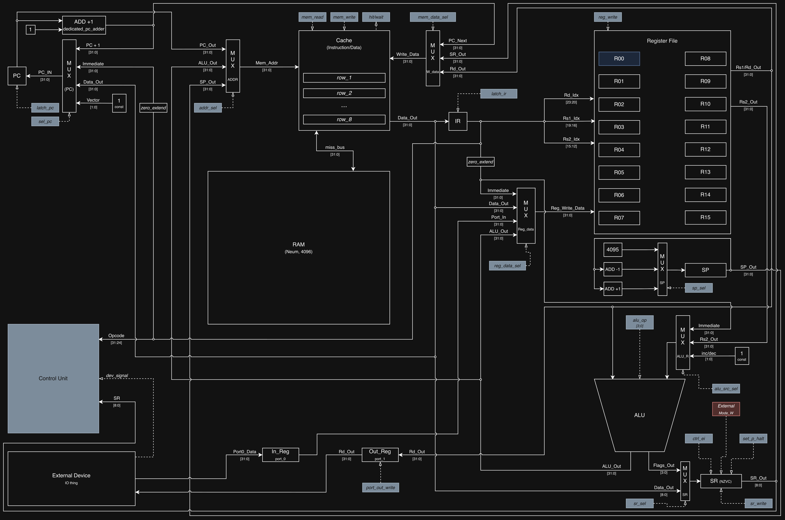
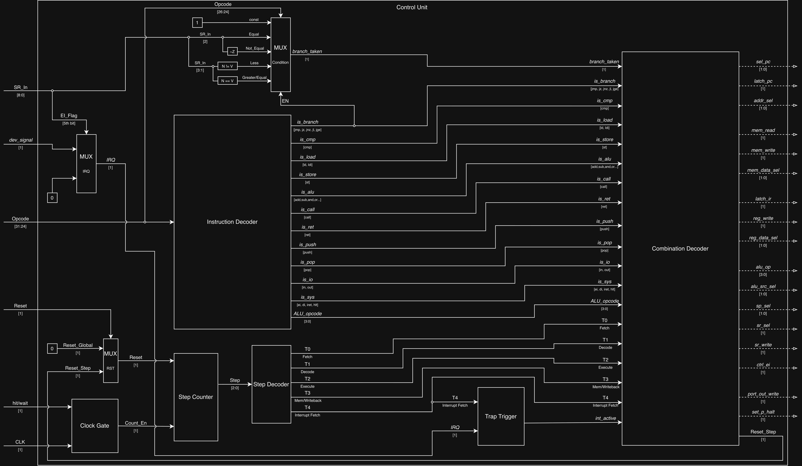

# Лабораторная работа №4. Эксперимент 
## (Вариант: lisp | risc | neum | hw | trap | port | pstr | cache | alg2)

**Студент:** Малых Кирилл Романович, P3232  
**Преподаватель:** Пенской Александр Владимирович  

---

## Table of Contents

- [Язык программирования](#язык-программирования)
- [Организация памяти](#организация-памяти)
- [Система команд](#система-команд)
- [Транслятор](#транслятор)
- [Модель процессора](#модель-процессора)
- [Тестирование](#тестирование)

---

## Язык программирования

Разработанный язык программирования представляет собой минималистичный диалект **Lisp (S-expressions)** с поддержкой рекурсивных функций, глобальных и локальных переменных, арифметических операций, условных ветвлений и асинхронных прерываний.

### Синтаксис

```ebnf
program     = expression ;

expression  = number | string | name | list ;

list        = "(" , form , ")" ;

form        = setq | defun | definterrupt | progn | if
            | aref | aset | io | unary | binary | call ;

setq        = "setq" , name , expression ;
defun       = "defun" , name , "(" , { name } , ")" , expression ;
definterrupt= "definterrupt" , name , "(" , ")" , expression ;
progn       = "progn" , expression , { expression } ;
if          = "if" , expression , expression , expression ;

aref        = "aref" , expression , expression ;
aset        = "aset" , expression , expression , expression ;

io          = "in" , port
            | "out" , port , expression
            | "print" , expression
            | "ei" | "di" ;

unary       = ( "not" | "inc" | "dec" ) , expression ;

binary      = ( "+" | "*" ) , expression , expression , { expression }
            | ( "-" | "/" | "%" | "and" | "or" | "xor"
              | "lsl" | "lsr" | "<<" | ">>" ) , expression , expression
            | ( "=" | "!=" | "<" | "<=" | ">" | ">=" ) , expression , expression ;

call        = name , { expression } ;

port        = "0" | "1" ;
number      = [ "-" ] , digit , { digit } ;
string      = '"' , { character - '"' } , '"' ;
name        = letter , { letter | digit | "_" } ;
comment     = ";" , { character - newline } , newline ;
```

Операции сравнения разрешены только в позиции условия `if`: отдельного булева типа в языке нет, результат сравнения сразу превращается в команду ветвления.

### Семантика
* **Стратегия вычислений:** аппликативная (аргументы вычисляются перед вызовом функции).
* **Области видимости:** глобальные переменные хранятся в статической памяти данных (`symbol_table`). Локальные переменные (аргументы функций `defun`) маппятся на аппаратные регистры (`R1..Rn` по числу аргументов) и затеняют глобальные имена. Вложенных областей видимости нет: внутри функции видны её аргументы и все глобальные переменные.
* **Типизация:** динамическая слабая (целые 32-битные числа и указатели на Pascal-строки). Все языковые конструкции являются выражениями (`statement-as-expression`): `(print (setq x 13))`, `(setq x (if (= 1 x) 2 3))` и `(print (if (= 1 x) 84 70))` — корректный код. Конструкции `ei`, `di` и `defun` значения не возвращают, и попытка использовать их как операнд даёт ошибку трансляции.
* **Рекурсия:** поддерживается в полном объёме. Самовызов в хвостовой позиции транслятор превращает в переход на начало функции, поэтому циклы вида `(defun wait () (wait))` работают бесконечно и не расходуют стек.

### Литералы

| Вид | Пример | Где размещается |
|-----|--------|-----------------|
| Целое число от 0 до 65535 | `42` | Непосредственно в команде `LDI` |
| Отрицательное или большое число | `-1`, `70000` | Собирается в регистре парой `LDI` + `LSL` + `OR` |
| Строка | `"Hello"` | Сегмент данных, формат Pascal-строки |

---

## Организация памяти

Модель памяти процессора построена по принципу **фон Неймановской архитектуры (`neum`)**:
* Единое адресное пространство размером **4096 32-битных слов**.
* Адресация пословная: одно машинное слово — одна ячейка, `PC` увеличивается на 1.
* **Разделение адресного пространства:**

```text
       Единая память (4096 слов)
+--------------------------------------+
| 0000        : JMP _start             |  вектор сброса
| 0001        : JMP обработчик / IRET  |  вектор прерывания
| 0002        : начало программы       |
|    ...                               |  .text, тела функций и обработчиков
| 0999                                 |
+--------------------------------------+
| 1000        : переменная / строка    |  .data
|    ...                               |  глобальные переменные и Pascal-строки
| 3099                                 |
+--------------------------------------+
| 3100                                 |  .stack, растёт вниз
|    ...                               |
| 4095        : вершина стека (SP)     |
+--------------------------------------+
```

* Сегмент кода: `0..999` (`0x000..0x3E7`).
* Сегмент данных: `1000..3099` (`0x3E8..0xC1B`).
* Стек: `3100..4095` (`0xC1C..0xFFF`), `SP` инициализируется адресом 4095 и растёт вниз.

Транслятор проверяет, что код не вышел за адрес 1000, а данные — за адрес 3100, и отказывается собирать программу, если сегменты пересекаются. Модель процессора следит за `SP` и останавливается с диагностикой при переполнении или опустошении стека.

### Работа с данными

1. **Литералы.** Число, помещающееся в 16 бит, попадает прямо в поле команды `LDI` — это непосредственная адресация. Отрицательное или не помещающееся в 16 бит число собирается в регистре из двух половин, потому что поле команды физически меньше машинного слова. В статическую память числовые литералы не выносятся.
2. **Константы.** Отдельного понятия константы в языке нет, любое именованное значение — это переменная.
3. **Переменные.** Глобальные переменные живут в сегменте данных: каждому новому имени при первом `setq` выделяется одна ячейка, адреса раздаются подряд от 1000. Обращение идёт парой `LDI` (адрес) + `LD`/`ST`. Аргументы функции отображаются на регистры `R1..Rn` и в памяти не хранятся вовсе.
4. **Строки.** Строковый литерал размещается в сегменте данных в формате Pascal-строки: первое слово — длина, далее по одному ASCII-коду на машинное слово. Выражение со строкой возвращает адрес её начала, то есть указатель. Строки размещаются подряд по мере встречи в тексте программы. Работа со строками ведётся функциями на самом языке через `aref` и `aset`.
5. **Инструкции.** Одна инструкция — одно машинное слово. Программа начинается с таблицы векторов из двух слов, далее идёт код.
6. **Процедуры.** Тело функции размещается в сегменте кода по месту объявления, транслятор обходит его командой `JMP`. Вызов сохраняет адрес возврата в стек командой `CALL`. Перед вызовом активные регистры сохраняются в стек, после возврата восстанавливаются. Хвостовой самовызов компилируется в `JMP` и стек не трогает.
7. **Прерывания.** Обработчик размещается в сегменте кода как обычная функция, а в ячейку 1 ставится переход на него. Если обработчик не объявлен, в ячейке 1 стоит `IRET`. Контекст (`PC` и `PS`) сохраняется в стек аппаратно, регистры сохраняет сам обработчик — транслятор анализирует его тело и генерирует `PUSH`/`POP` только для тех регистров, которые обработчик действительно портит.

### Распределение регистров

Регистры `R1..R10` используются как стек вычислений: каждое промежуточное значение занимает очередной свободный регистр и освобождается сразу после использования. Первые `n` регистров заняты аргументами текущей функции.

Если выражение настолько глубоко вложено, что регистров не хватает, транслятор останавливается с ошибкой «закончились свободные регистры». Выгрузка регистров в память не реализована сознательно: предел достигается примерно на одиннадцатом уровне вложенности, что для задач варианта избыточно, а механизм spill заметно усложнил бы транслятор.

---

## Система команд

Процессор реализован по принципам архитектуры **RISC**:
* Фиксированная длина команд — **32 бита**.
* Обработка данных выполняется **строго в регистрах**.
* Доступ к памяти — отдельными командами `LD` и `ST`.
* Регистровый файл: 16 регистров (`R0` – `R15`), где `R0` аппаратно заземлен на ноль, а `PC`, `SP`, `CR` и `PS` вынесены как отдельные аппаратные регистры.
* Типы данных: 32-битное целое со знаком в дополнительном коде. Указатель на строку — то же 32-битное число.

### Кодирование инструкций

Все команды занимают ровно одно 32-битное слово. Используются два формата:

```text
Регистровый формат (три регистра)
 31      24 23   20 19   16 15   12 11            0
+----------+-------+-------+-------+---------------+
|  opcode  |  Rd   |  Rs1  |  Rs2  |   не исп.     |
+----------+-------+-------+-------+---------------+
     8         4       4       4          12

Формат с непосредственным операндом
 31      24 23   20 19   16 15                    0
+----------+-------+-------+-----------------------+
|  opcode  |  Rd   |  Rs1  |      immediate        |
+----------+-------+-------+-----------------------+
     8         4       4              16
```

Первый формат применяется к трёхрегистровым операциям АЛУ (`ADD`, `SUB`, `MUL`, `DIV`, `MOD`, `AND`, `OR`, `XOR`, `LSL`, `LSR`), второй — ко всем остальным командам. Поле `immediate` хранит константу, адрес перехода, смещение при обращении в память или номер порта.

Примеры:

```text
0x04123000   ADD R1, R2, R3      opcode=04, Rd=1, Rs1=2, Rs2=3
0x0110002A   LDI R1, 42          opcode=01, Rd=1, imm=0x002A
0x02120005   LD  R1, R2, 5       opcode=02, Rd=1, Rs1=2, imm=5
0x1C100001   OUT 1, R1           opcode=1C, Rd=1, imm=1 (номер порта)
0x12000044   JMP 68              opcode=12, imm=0x0044
```

### Набор инструкций и количество тактов

Полный цикл команды — это последовательность шагов счётчика `Step Counter`: `T0 Fetch`, `T1 Decode`, `T2 Execute`, при необходимости `T3 Mem/WB`. Каждый шаг занимает один такт. К этому добавляется ожидание памяти: попадание в кеш стоит 1 такт, промах — 13 тактов, сквозная запись — всегда 10 тактов.

| Команда | Действие | Всё в кеше | Промах выборки | Промах выборки и данных |
|---------|----------|-----------:|---------------:|------------------------:|
| `LDI Rd, imm` | `imm -> Rd` | 3 | 15 | — |
| `ADD/SUB/MUL/DIV/MOD Rd, Rs1, Rs2` | арифметика | 3 | 15 | — |
| `AND/OR/XOR/LSL/LSR Rd, Rs1, Rs2` | логика и сдвиги | 3 | 15 | — |
| `NOT Rd, Rs1` | `~Rs1 -> Rd` | 3 | 15 | — |
| `INC/DEC Rd` | `Rd ± 1 -> Rd` | 3 | 15 | — |
| `CMP Rd, Rs1` | `Rd - Rs1 -> NZVC` | 3 | 15 | — |
| `JMP/JZ/JNZ/JL/JGE addr` | переход | 3 | 15 | — |
| `IN Rd, port` | порт `-> Rd` | 3 | 15 | — |
| `OUT port, Rd` | `Rd ->` порт | 3 | 15 | — |
| `EI` / `DI` | разрешить/запретить прерывания | 3 | 15 | — |
| `LD Rd, Rs1, off` | `Mem[Rs1+off] -> Rd` | 4 | 16 | 28 |
| `POP Rd` | снять со стека | 4 | 16 | 28 |
| `RET` | возврат из функции | 4 | 16 | 28 |
| `ST Rd, Rs1, off` | `Rd -> Mem[Rs1+off]` | 13 | 25 | — |
| `PUSH Rd` | положить в стек | 13 | 25 | — |
| `CALL addr` | вызов функции | 13 | 25 | — |
| `IRET` | возврат из прерывания | 5 | 17 | 29 |
| `HLT` | останов | 2 | 14 | — |

Запись идёт сквозная, поэтому всегда стоит 10 тактов независимо от состояния кеша. Отдельно стоит шаг `T4 Interrupt Fetch`: аппаратное сохранение `PC` и `PS` в стек занимает **20 тактов**.

### Ввод-вывод

Ввод-вывод портовый (`port`): порт `0` — ввод, порт `1` — вывод. Обращение возможно только командами `IN` и `OUT`, номер порта кодируется в поле `immediate`.

Внешнее устройство имеет один регистр данных и одну линию запроса. Получив байт, устройство кладёт его в регистр `In_Reg` и поднимает `dev_signal`. Команда `IN` забирает байт и снимает запрос. Если новый байт приходит раньше, чем процессор прочитал предыдущий, предыдущий теряется, и модель пишет об этом в журнал: никакой очереди у порта нет.

### Система прерываний

Прерывания внутренние и обрабатываются аппаратно. Запрос образуется схемой `И`: `IRQ = dev_signal & IE`. Запрос проверяется только на границе команд. При срабатывании процессор переходит на шаг `T4`, сохраняет `PC` и `PS` в стек, сбрасывает `IE` и переходит на вектор по адресу 1.

Поскольку `IE` сброшен, прерывание во время обработки прерывания не возникает: запрос остаётся висеть на линии и обслуживается сразу после `IRET`. Если за время обработки придёт ещё один байт, он затрёт предыдущий — это поведение реального устройства без буфера, и оно продемонстрировано в golden-тесте `interrupt_burst`.

### Классификация

Система команд относится к **RISC**: фиксированная длина команды, операции только над регистрами, отдельные команды доступа к памяти, минимальный набор режимов адресации (непосредственная, регистровая, регистровая со смещением).

---

## Транслятор

Консольное приложение (`translator.py`) реализует двухпроходный компилятор.

**Интерфейс командной строки:**
```bash
python3 src/translator.py -i <input.lisp> -o <target.bin> [-l <listing.txt>]
```

| Ключ | Назначение |
|------|------------|
| `-i`, `--input` | Исходный файл на разработанном языке |
| `-o`, `--output` | Выходной бинарный файл с машинным кодом |
| `-l`, `--listing` | Отладочный листинг (необязательно) |

**Этапы трансляции:**
1. **Токенизация:** разбиение текста на лексемы с сохранением строковых литералов и удалением комментариев (`;`).
2. **Парсинг (AST):** рекурсивный спуск с построением вложенного дерева выражений.
3. **Сбор сигнатур:** предварительный обход дерева, чтобы функция была видна до места её объявления.
4. **Семантический анализ:** проверка зарезервированных имен, арности функций, валидация портов и лимита регистров.
5. **Генерация кода:** рекурсивный обход AST, динамическое выделение регистров `R1..R10` и трансляция в RISC-инструкции. Тело функции компилируется в хвостовой позиции, самовызов превращается в переход.
6. **Компоновка (Linker):** двухпроходное разрешение символических меток в числовые адреса памяти, построение таблицы векторов.
7. **Сериализация:** запись 32-битного дампа памяти в настоящий бинарный файл через `struct.pack` и генерация отладочного листинга `<address> - <HEXCODE> - <mnemonic>`.

---

## Модель процессора

Консольное приложение (`machine.py`) реализует потактовый симулятор процессора с жесткой логикой управления (Hardwired Control Unit — `hw`) и кэш-памятью (`cache`).

**Интерфейс командной строки:**
```bash
python3 src/machine.py -c <code.bin> [-i <input.txt>] [-t <max_ticks>] [--no-cache]
```

| Ключ | Назначение |
|------|------------|
| `-c`, `--code` | Бинарный файл с машинным кодом |
| `-i`, `--input` | Файл с расписанием ввода (текст или JSON-список пар) |
| `-t`, `--ticks` | Лимит тактов симуляции |
| `--no-cache` | Отключить кеш, каждое обращение в память стоит 10 тактов |

### DataPath



| Элемент | Назначение |
|---------|------------|
| `Register File` | 16 регистров `R0..R15`, `R0` заземлён на ноль |
| `PC` | Счётчик команд, увеличивается выделенным сумматором `+1` |
| `SP` | Указатель стека, меняется сумматорами `+1` и `-1` |
| `IR` | Регистр команды, с него декодер снимает поля `Rd`, `Rs1`, `Rs2`, `imm` |
| `SR` | Регистр состояния `NZVC`, `IE`, `W`, `P` |
| `ALU` | Арифметика, логика и сдвиги, выставляет флаги |
| `Cache` | Кеш между процессором и ОЗУ, через него идут и команды, и данные |
| `RAM` | Единая память на 4096 слов |
| `In_Reg` / `Out_Reg` | Регистры данных портов 0 и 1 |

Управляющие сигналы: `latch_pc`, `sel_pc`, `addr_sel`, `mem_read`, `mem_write`, `mem_data_sel`, `latch_ir`, `reg_write`, `reg_data_sel`, `alu_op`, `alu_src_sel`, `sp_sel`, `sr_sel`, `sr_write`, `ctrl_ei`, `port_out_write`, `set_p_halt`. Обратно в ControlUnit идут `Opcode`, `SR` и `dev_signal`, а от кеша — `hit/wait`.

### ControlUnit



Устройство управления построено на жёсткой логике. `Instruction Decoder` разбирает опкод на признаки (`is_alu`, `is_branch`, `is_load`, `is_store`, `is_call`, `is_io`, `is_sys` и прочие), `Step Counter` хранит номер шага, а `Combination Decoder` по паре «признак команды + номер шага» выдаёт управляющие сигналы.

| Шаг | Что происходит |
|-----|----------------|
| `T0 Fetch` | Адрес из `PC` идёт в кеш, слово защёлкивается в `IR` |
| `T1 Decode` | Декодер разбирает поля команды |
| `T2 Execute` | Работа АЛУ, регистрового файла, портов, расчёт адреса |
| `T3 Mem/WB` | Обращение в память через кеш и запись результата в регистр |
| `T4 Interrupt Fetch` | Сохранение `PC` и `PS` в стек, переход на вектор |

Команды, которым память не нужна, завершаются на шаге `T2` сигналом `Reset_Step`. Шаг `T4` выполняется только при активном запросе прерывания.

**Clock Gate.** Пока кеш не ответил, сигнал `hit/wait` снимает разрешение `Count_En`, и `Step Counter` замирает. В журнале это видно как строки `STALL`: процессор физически ждёт память.

**Trap Trigger.** Схема запоминает, что процессор вошёл в обработчик прерывания, и выставляет `int_active`. В журнале этому соответствует колонка `INT`.

### Флаги регистра состояния

| Бит | Флаг | Смысл |
|-----|------|-------|
| 0 | `C` | Перенос |
| 1 | `V` | Переполнение знакового результата |
| 2 | `Z` | Результат равен нулю |
| 3 | `N` | Результат отрицателен |
| 5 | `IE` | Прерывания разрешены |
| 7 | `W` | Непрерывный режим работы |
| 8 | `P` | Процессор работает |

### Кеш-память

Кеш прямого отображения: **8 строк по 4 слова**, итого 32 слова. Номер блока — это `адрес / 4`, строка выбирается как `блок % 8`, тег хранит номер блока. Запись сквозная.

Промах подтягивает из памяти блок целиком: первое слово стоит полной задержки в 10 тактов, остальные три приходят следом по такту, итого 13 тактов. Попадание стоит 1 такт. Блок из нескольких слов даёт пространственную локальность: подряд идущие команды после одного промаха читаются из кеша.

### Особенности моделирования

Модель потактовая: метод `tick()` выполняет ровно один такт, то есть один шаг счётчика, и симуляцию можно остановить на любом такте. Код модели повторяет схему: защёлки `IR`, `PC`, `SP`, `SR` — это поля `DataPath`, шаги `T0..T4` — отдельные методы `ControlUnit`, а ожидание памяти реализовано счётчиком `stall_ticks`, который и есть `Clock Gate`.

Журнал пишется на каждый такт и содержит номер такта, шаг, `PC`, машинное слово, мнемонику, регистры, `SP`, флаги, состояние кеша и признак работы в прерывании:

```text
|  TICK  | STEP      |  PC  | HEX CODE | INSTRUCTION            |   R1   |   R2   |   SP   |  NZVC  |   CACHE   | INT  |
|   99   | T1 DECODE |  10  | 1200000A | JMP R0, R0, 10         |   0    |   0    |  4094  |  0000  |  HIT (1)  |  -   |
[ТАКТ 100] ВУ прислало символ 'A' (ASCII 65), провод IntRq = 1!
|  100   | T2 EXEC   |  10  | 1200000A | JMP R0, R0, 10         |   0    |   0    |  4094  |  0000  |  HIT (1)  |  -   |
[ТАКТ 101] Вход в прерывание: PC и PS сохранены в стек
|  101   | T4 INT    |  1   | 1200000A | JMP R0, R0, 10         |   0    |   0    |  4092  |  0000  | WRITE(10) | INT  |
```

---

## Тестирование

Тестирование транслятора и модели процессора реализовано с помощью фреймворка **`pytest`**.

```bash
pytest -v                      # все тесты
pytest -v tests/test_golden.py # только интеграционные
pytest --update-goldens        # пересобрать эталоны
```

### Юнит-тесты

* `tests/test_translator.py` — разбор S-выражений и ошибки синтаксиса, Pascal-строки, таблица векторов прерываний, вариативная арифметика, `aref`/`aset`, проверка того, что хвостовой самовызов компилируется в `JMP`, а обычный рекурсивный вызов остаётся `CALL`.
* `tests/test_machine.py` — задержки и вытеснение кеша, пространственная локальность блока, режим без кеша, флаги `NZVC`, деление на ноль, заземление `R0`, рекурсия через аппаратный стек, отсутствие роста стека при хвостовой рекурсии, останов по лимиту тактов.

### Golden-тесты

Каждый тест — один файл, в нём лежат исходный алгоритм, расписание ввода, лимит тактов, машинный код с мнемониками, вывод программы и журнал работы процессора. Журнал обрезается до репрезентативного объёма: сохраняются начало, конец и все строки событий.

| Тест | Что демонстрирует |
|------|-------------------|
| [hello.yml](tests/golden/hello.yml) | Печать Pascal-строки из сегмента данных функцией на языке |
| [cat.yml](tests/golden/cat.yml) | Эхо ввода через прерывания, бесконечный фоновый цикл |
| [hello_user_name.yml](tests/golden/hello_user_name.yml) | Приглашение, приём имени в буфер, приветствие |
| [sort.yml](tests/golden/sort.yml) | Сортировка списка, загруженного с префиксом длины |
| [collatz.yml](tests/golden/collatz.yml) | Алгоритм варианта `alg2`: длина последовательности Коллатца |
| [infix_to_rpn.yml](tests/golden/infix_to_rpn.yml) | Алгоритм варианта `alg2`: перевод в обратную польскую запись |
| [double_precision.yml](tests/golden/double_precision.yml) | Арифметика двойной точности: сложение 64-битных чисел |
| [linear_filter.yml](tests/golden/linear_filter.yml) | Скользящее окно, демонстрация работы кеша |
| [interrupt_burst.yml](tests/golden/interrupt_burst.yml) | Прерывание во время прерывания и потеря непрочитанного байта |

### Влияние кеша на производительность

Замер сделан на одних и тех же программах с кешем и с ключом `--no-cache`:

| Программа | Без кеша | С кешем | Ускорение | Попаданий |
|-----------|---------:|--------:|----------:|----------:|
| `collatz` | 29803 | 10287 | 2.9x | 94% |
| `hello` | 3549 | 1638 | 2.2x | 78% |
| `hello_user_name` | 12287 | 6185 | 2.0x | 76% |
| `linear_filter` | 24619 | 13015 | 1.9x | 73% |
| `double_precision` | 35459 | 20318 | 1.7x | 70% |
| `sort` | 21801 | 14578 | 1.5x | 66% |
| `infix_to_rpn` | 17035 | 12825 | 1.3x | 71% |

Больше всего выигрывают программы с плотными циклами: тело цикла целиком помещается в кеш и читается оттуда на каждой итерации.

### Пример использования инструментальной цепочки

```console
$ cat hello.lisp
(progn
    (setq msg "Hello, World!")

    (defun print_str (s i)
        (if (> i (aref s 0))
            0
            (progn
                (out 1 (aref s i))
                (print_str s (+ i 1)))))

    (print_str msg 1)
)

$ python3 src/translator.py -i hello.lisp -o hello.bin -l hello.txt
Машинный код записан в: hello.bin
Отладочный листинг записан в: hello.txt

$ head -5 hello.txt
0000 - 0x12000002 - JMP 2
0001 - 0x1F000000 - IRET
0002 - 0x011003E9 - LDI R1, 1001
0003 - 0x012003E8 - LDI R2, 1000
0004 - 0x03120000 - ST R1, R2, 0

$ python3 src/machine.py -c hello.bin -t 4000
...
|  1638  | T1 DECODE |  35  | 20000000 | HLT R0, R0, 0 | ... |  HIT (1)  |  -   |
Процессор остановлен, выполнено тактов: 1638
Выполнено инструкций: 269
Попаданий (Hits): 234 | Промахов (Misses): 65 | Hit Rate: 78.26%

========================================
Hello, World!
========================================
```

### CI

Сборка настроена через GitHub Actions и на каждый push выполняет:

```yaml
- ruff check src/ tests/        # линтер, включены все правила
- ruff format --check src/ tests/  # автоформаттер
- mypy src/                     # строгая проверка типов
- pytest -v                     # юнит- и golden-тесты
```

Набор правил `ruff` выставлен как `select = ["ALL"]`. Каждое отключённое правило снабжено обоснованием в `pyproject.toml`: отключены проверки, которые конфликтуют с форматтером, требуют докстринги и лицензионные шапки, запрещают кириллицу в тексте, а также правила, противоречащие устройству задачи — длинные цепочки `if/elif` в декодере команд и модульное состояние транслятора.
